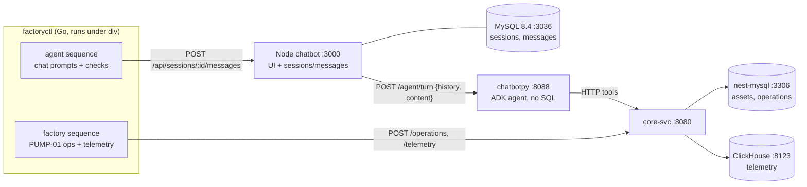

# Acute plan: factory operations and agent chat running at the same time

Source: [ACUTE-GOAL.md](ACUTE-GOAL.md) and the photo `IMG_1503.HEIC` ("Goal Today", "B4 11:15, running automation"). Budget: **10 prompts or fewer**. The prompts are below, ready to paste.

## What the goal changes in PLAN-chatbot-ui.md

| Topic | PLAN-chatbot-ui.md | Acute goal (and photo) | What we do |
| --- | --- | --- | --- |
| UI | Port the widget into `chatbotpy/web`, served on 8088 | "Deploy UI / Chatbot", Node app, its DB on **3036** | **Keep the Node app** (`../chatbot`, UI on :3000, DB on :3036). Keep only `sessions` and `messages`. A session is a thread. |
| Backend | core-svc as api-svc (JWT, projects) | Core-Svc on 3306. **The photo says "Nest-Axum"**; the goal file says core-svc | **core-svc** (Actix, :8080) on nest-mysql :3306. The goal file is newer and matches your last instruction. |
| chatbotpy | ADK `DatabaseSessionService`, `mes_engine`, VECTOR table | **MUST NOT have any direct SQL** | All tools are HTTP calls to core-svc. Sessions use ADK `InMemorySessionService`, rebuilt each turn from the history the Node server sends. Remove `sqlalchemy` and `pymysql`. |
| MySQL | MySQL 9 (:3037) for chatbotpy and the MES mock | MySQL only for nest services | **Retire chatbotpy's MySQL 9 and the MES mock.** Asset and operation data go in nest-mysql through core-svc. |
| Sensor data | `mes.sensor_readings` | **ClickHouse**, Docker image and config inside core-svc | `nest/core-svc/clickhouse/` (compose, config, init SQL). core-svc writes and reads telemetry. |
| Factory operations | none | Pump with Perception-layer sensors, "send data", "Ascend ↑" (photo) | A simulator runs a pump scenario: start, ramp up, a fault with **rising vibration**, then stop. It sends operations and telemetry to core-svc. |
| Running it all | per-service commands | "full automation, using dlv cli if possible" | **`dlv` (Delve 1.25.2) only debugs Go.** So the simulator and runner are written in **Go** and run under `dlv`. core-svc uses `rust-lldb`, chatbotpy `debugpy`, and Node `--inspect`. |
| Auth, projects, embeddings | Phases A3–A6 and E | not mentioned | **Postponed.** Everything runs on localhost without auth. Embeddings would need a SQL `VECTOR` column, which chatbotpy can no longer use. |

## Target

The factory sequence and the agent sequence run **at the same time** in one `factoryctl run` (two goroutines working from one scenario file). The agent's answers have to reflect what the factory is doing at that moment, e.g. "PUMP-01 vibration is rising".

## The prompts

Each prompt ends with a check, and the next prompt only starts once that check passes.

**1. core-svc base (nest).**
> In nest/core-svc: bind to `cfg.host`/`cfg.port`, build the DB URL from secrets (remove the hard-coded `mysql://nest:nest@…`), return JSON errors `{error}`, add `GET /health` (MySQL). Move `core-axum-svc/migrations/*` to `nest/database/migrations/` without changing them, and have core-svc run them with `sqlx::migrate!`. core-axum-svc is no longer used. Add migration 008 `operation_log(id, asset_uid, op, params JSON, actor, ts)` and migration 009 seeding a pump station: `functional_location` STATION-1 → PUMP-01, a `Pump` asset plus a `Motor` and Perception-layer `Sensor` assets (pressure, flow, vibration, bearing_temp) with limits. Check: `cargo test -p core-svc`, `curl :8080/health`, `_sqlx_migrations` has 9 rows.

**2. ClickHouse in core-svc.**
> Use the **existing container `d4fd9cc75f6912ee16dbdd3836a09ca711816aa911190bd1c20feafd35b61a44`** (`elated_hugle`, image `clickhouse/clickhouse-server:latest`, server 26.10.3.7, HTTP on host port 8123; 9000 isn't published). Don't recreate it. Add `nest/core-svc/clickhouse/` with `users.d/nest.xml.tmpl` (a `nest` user with a SHA-256 password, open to all networks, access limited to database `nest`), `init/001_telemetry.sql` (`nest.telemetry(equipment, tag, ts DateTime64(3,'UTC'), value Float64)` MergeTree ordered by (equipment, tag, ts), with a 30-day TTL), and `apply.sh`. The script starts the container if it's stopped, generates the password into a gitignored `clickhouse/.env`, copies the user file into `/etc/clickhouse-server/users.d/`, and runs the init SQL. A `compose.yaml` with the same image is kept only for rebuilding from scratch. core-svc talks to ClickHouse over HTTP with `reqwest` (`FORMAT JSONEachRow` and query parameters). `GET /health` also reports ClickHouse. Check: `apply.sh` is idempotent and `/health` shows both stores.

**3. core-svc API for operations, telemetry and the agent.**
> Add to core-svc: `POST /telemetry` (batch up to 5k points into ClickHouse), `POST /operations` (writes `operation_log` and updates `asset.status`: start→Active, stop→Standby, fault→Faulted), `GET /assets`, `GET /assets/{uid}` (status, location, sensors with limits, last operation), `GET /assets/{uid}/telemetry/summary?tag&window=15m` (min, max, avg, last, slope, out-of-limit count, from ClickHouse), `GET /assets/{uid}/operations?limit`. Check: actix tests plus a curl script that posts telemetry and reads back the summary.

**4. Go factory simulator `factoryctl` (nest/tools/factoryctl).**
> A Go CLI with `factoryctl sim scenario.yaml`. The scenario holds timed steps (`start PUMP-01`, `ramp flow 0→120 over 60s`, `fault cavitation: vibration ascends 2→9 mm/s over 120s`, `stop`). It sends telemetry every 1 s (all tags, with noise) and posts operations to core-svc. Include `scenarios/pump-cavitation.yaml`. Check: `dlv debug ./tools/factoryctl -- sim scenarios/pump-cavitation.yaml` hits a breakpoint in the send loop, and ClickHouse fills with rows.

**5. chatbotpy: no SQL, HTTP-only agent.**
> In chatbotpy: remove `app/db.py`, `app/datasource/*`, the `ping` and `analyze-datasource-schema` skills, the `sqlalchemy`/`pymysql` deps, the MySQL 9 compose service and `db/*.sql`. Add `integrations/core_svc.py` (httpx with timeouts and retries) and ADK `LlmAgent` tools `list_assets`, `get_asset`, `get_telemetry_summary` and `get_operations`, all calling core-svc. Add FastAPI `POST /agent/turn {session_id, history:[{role,content}], content}` → `{reply, tools_used}`, using `InMemorySessionService` seeded from `history`, and `GET /health`. Model through LiteLlm (Claude). Add `tests/test_no_sql.py`, which fails if any `app/` file imports sqlalchemy, pymysql, aiomysql or mysql, or contains SQL keywords in strings. Check: pytest passes and a curl to `/agent/turn` returns a reply naming the tools it used.

**6. Node chatbot as the UI.**
> In ../chatbot: `server/src/bot.js` calls chatbotpy `POST /agent/turn` (with `CHATBOTPY_URL`) instead of Anthropic directly. Keep the `sessions` and `messages` tables and add a nullable `tools_used JSON` column to `messages` (migration in `db/`). The UI shows tool chips under assistant messages and a small **PUMP-01 panel** (status plus a vibration and flow sparkline) that polls `GET /api/factory/PUMP-01`, which the Node server forwards to core-svc. Check: `docker compose up` on :3000, chat about PUMP-01 shows chips, and the panel moves while the sim runs.

**7. Running both at the same time: `factoryctl run`.**
> Add `factoryctl run scenario.yaml`. It runs the factory sequence and an `agent:` sequence **in parallel** (errgroup). Agent steps fire at a time or when an event happens (`at: 90s` or `on: fault`) and post to the Node API `POST /api/sessions/:id/messages`. Each step checks the reply (`expect_tools: [get_telemetry_summary]`, `expect_text: /vibration.*(rising|increas)/i`). Output is a JSON and terminal report: a timeline of operations and agent turns, with pass/fail per step. Check: `factoryctl run scenarios/pump-cavitation.yaml` passes at least 3 agent checks.

**8. One-command automation and debugging.**
> Add `nest/scripts/stack.sh up|down|status|run|debug <svc>`. `up` starts nest-mysql, ClickHouse, core-svc, chatbotpy and the Node chatbot in order, waiting for each `/health` (or healthcheck). `status` prints one line per service. `run` runs `factoryctl run`. `debug factoryctl` uses `dlv debug`, `debug core-svc` uses `rust-lldb`, `debug chatbotpy` uses `python -m debugpy --listen 5678`, and `debug chatbot` uses `node --inspect`. Add `.vscode/launch.json` entries for the same. Check: from everything stopped, `stack.sh up && stack.sh run` is green.

**9. Full run and fixes.**
> Run `stack.sh down && stack.sh up && stack.sh run` twice. Fix whatever fails. Confirm that chatbotpy has no SQL (test_no_sql), that only nest services and the Node chatbot connect to MySQL, that ClickHouse holds the scenario's telemetry, and that the Node chat shows the agent turns from the run.

**10. Spare.** Kept for whatever prompt 9 turns up, or for docs: update READMEs and replace PLAN-chatbot-ui.md's phases with this plan.

## Risks

- **`dlv` covers only the Go parts.** That's the reason `factoryctl` is written in Go. If "dlv" meant a different tool, prompts 4, 7 and 8 change.
- **The photo says "Nest-Axum".** This plan uses core-svc. If axum is wanted, prompts 1–3 target `core-axum-svc` instead (it already runs migrations).
- **Port 3036 is the Node app's MySQL.** The UI itself is on :3000. If the UI must *listen* on 3036, the Node DB's host port has to move.
- **The ClickHouse container `d4fd9cc75f69` has no restart policy**, so it's down after a Docker restart. `stack.sh up` and `apply.sh` run `docker start` on it. Its `default` user only works from inside the container. Everything outside uses the `nest` user.
- **The LLM is non-deterministic**, so the checks in prompt 7 use loose regexes plus `expect_tools` rather than exact text.

## Status (2026-10-31): implemented

| Prompt | State | Where |
| --- | --- | --- |
| 1 core-svc base | Done. Config-driven bind and DB URL (`DATABASE_URL` from env or `core-svc/.env`, then secrets), JSON errors, `/health`, migrations 008 (`operation_log`, `channel_limit`) and 009 (STATION-1 / PUMP-01 seed) | `nest/core-svc`, `nest/database/migrations` |
| 2 ClickHouse | Done. Container `d4fd9cc75f69` reused, `nest` user and `nest.telemetry` applied by `apply.sh` | `nest/core-svc/clickhouse/` |
| 3 core-svc API | Done. `GET /equipment[/{tag}[/operations, /telemetry, /telemetry/summary]]`, `POST /operations`, `POST /telemetry` | `nest/core-svc/src/{clickhouse.rs,handlers/factory_handler.rs,…}` |
| 4 + 7 factoryctl | Done. `sim`, `run` (factory and agent sequences in parallel goroutines, with checks), `validate`. Debug with `dlv debug ./tools/factoryctl` | `nest/tools/factoryctl`, `nest/go.work` |
| 5 chatbotpy | Done, with one change: **Claude through the `anthropic` SDK tool runner instead of ADK + LiteLLM**, because Opus 5.5 rejects `temperature` and forced `tool_choice` and needs its thinking blocks passed back unchanged, which a translation layer can break. An offline rule-based agent runs when there's no key. No SQL, enforced by `tests/test_no_sql.py` | `chatbotpy/app` |
| 6 Node chatbot | Done. Replies come from chatbotpy, `messages.tools_used` column added, tool chips, live PUMP-01 panel | `../chatbot` |
| 8 automation | Done. `nest/scripts/stack.sh up|status|run|down|debug|logs`, `.vscode/launch.json` | `nest/scripts`, `nest/.vscode` |
