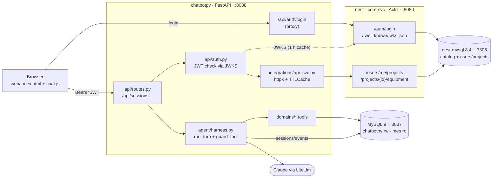

# Plan: Chatbot UI (JavaScript) on chatbotpy, MySQL and core-svc

This plan turns [PLAN-chatbotpy.md](PLAN-chatbotpy.md) into a running system by naming the real parts:

- **UI:** a plain JavaScript chat UI, ported from the Node app's `public/` widget in `../chatbot`.
- **Backend agent:** chatbotpy (FastAPI + Google ADK).
- **Data:** MySQL 9 for chatbotpy and the MES mock. MySQL 8.4 (`nest-mysql`) for the nest catalog.
- **api-svc:** nest's **`core-svc`** (Actix). It takes the api-svc role from PLAN-chatbotpy.md: login, tokens, projects and which equipment each project contains.

`core-axum-svc` is not used. The Node app in `../chatbot` is left running as it is and is only a source to copy UI code from.

## Where things stand (2026-10-31)

| Part | State | Gap this plan closes |
| --- | --- | --- |
| Node chat widget (`../chatbot/public`, about 500 lines) | Works, port 3000 | Has no auth, no project and no tool output. Calls the Node API shape. |
| chatbotpy | Step 0: config, DB engines, `ping` and `analyze-datasource-schema` | No FastAPI app, agent, routes or `web/` |
| chatbotpy MySQL 9 (port 3037) | `chatbotpy` (rw) and `mes` (ro) schemas up, MES mock seeded | ADK tables and the VECTOR round trip aren't checked yet |
| core-svc (port 8080) | Todo demo only | No auth, users, projects or `/health`. DB URL and port are hard-coded. Can't run migrations. |
| nest-mysql 8.4 (port 3306) | 30 catalog tables from `core-axum-svc/migrations`, mostly empty | No users or projects, and no link from catalog to MES equipment IDs |

## Architecture



The browser only talks to chatbotpy, so the UI needs no CORS setup. Login is the one call chatbotpy forwards to core-svc unchanged. chatbotpy never stores passwords.

### Decisions made here (change them before starting if they're wrong)

| # | Decision | Why |
| --- | --- | --- |
| D1 | **Plain JS, no build step.** Port `../chatbot/public` into `chatbotpy/web/`, served by FastAPI at `/`. | The existing widget already handles sessions, optimistic sends, typing and errors. A framework adds tooling for about 600 lines of UI. |
| D2 | **core-svc issues RS256 JWTs** from a dev login (`POST /auth/login`) and publishes JWKS. | That's what PLAN-chatbotpy.md assumes of api-svc, so chatbotpy's auth code doesn't change if a real IdP replaces it later. |
| D3 | **Users and projects become tables in nest** (`app_user`, `project`, `project_member`, `project_location`). | The plan makes api-svc the owner of users and projects, and nest has nowhere else to keep them. |
| D4 | **A project is a set of `functional_location` subtrees.** Its equipment is every location in those subtrees that has an `external_system_ref` with `system_kind = 'Mes'`. `external_ref` is the MES `equipment_id`, e.g. `PRESS-04`. | It uses the catalog as designed, without changing the `asset.class_code` enum (which has no press, CNC or oven). Motors, pumps and sensors stay assets placed under the machine's location. |
| D5 | **Migrations move to `nest/database/migrations/`** and core-svc runs them with `sqlx::migrate!("../database/migrations")`. | core-svc can't run migrations today, and `core-axum-svc` is out. The 7 existing files move unchanged, so their checksums in `_sqlx_migrations` still match. |
| D6 | **Ports:** core-svc stays on 8080. chatbotpy moves to **8088**. The Node app keeps 3000. | 8080 is taken, and the old plan's `8080:8080` would clash. |
| D7 | **Model: Claude through ADK's `LiteLlm`**, using the `ANTHROPIC_API_KEY` the Node app already uses. | The Node app already runs on it. Switching to Gemini is just a change to `MODEL`. |
| D8 | **Analysis embeddings come last** (phase E). | The UI, auth and tools don't depend on them, and the embedding model is still undecided (it fixes `VECTOR(n)`). |

## Phase A: core-svc as api-svc (nest repo)

| # | Work | Done when |
| --- | --- | --- |
| A1 | **Cleanup:** bind to `cfg.host`/`cfg.port` (it ignores config today). Build the DB URL from `secrets` instead of the hard-coded `mysql://nest:nest@…` in `main.rs:76`. Return JSON errors `{ "error": "..." }`. Add `GET /health`, which runs `SELECT 1`. | `curl :8080/health` → 200 with DB status. No credentials left in source. |
| A2 | **Migrations:** move `core-axum-svc/migrations/*` to `database/migrations/`. Add `sqlx` features `macros` and `migrate` to core-svc and run `migrate!` at startup. If `core-axum-svc` stays in the workspace, point its `migrate!` at the same folder. | core-svc starts on the existing DB and applies nothing new. `_sqlx_migrations` still has 7 rows. |
| A3 | **Migration `…008_create_auth_projects.sql`:** `app_user(id, username UNIQUE, display_name, password_hash, roles JSON, enabled)`, `project(id VARCHAR(64) PK, name)`, `project_member(project_id, user_id, role)`, `project_location(project_id, functional_location_id)`. | Tables exist with FKs to `functional_location`. |
| A4 | **Migration `…009_seed_dev_plant.sql`** (dev only): a location tree `PLANT-1 → Stamping / Machining / Finishing`, with one location per MES machine (`PRESS-01`, `PRESS-04`, `CNC-07`, `OVEN-02`) and an `external_system_ref (Mes, '<equipment_id>')` for each. Projects `P-STAMP` (Stamping) and `P-MACH` (Machining + Finishing). Users `alice` in P-STAMP, `bob` in P-MACH, `admin` in both. | The IDs match `chatbotpy/db/002_mes_mock.sql` exactly. |
| A5 | **Auth module** (`handlers/auth_handler.rs`, `services/auth_service.rs`): `POST /auth/login {username, password}` → `{access_token, expires_in}`. Passwords hashed with `argon2`. Tokens signed with `jsonwebtoken` RS256 by a key loaded from a path in `secrets.json`, and a `kid` header. `GET /.well-known/jwks.json`. Claims: `sub` (user id), `iss=core-svc`, `aud=chatbotpy`, `exp` (1 h), `roles`, `name`. An Actix extractor `AuthUser` checks the Bearer token on protected routes. | A wrong password → 401. The token verifies against the JWKS with PyJWT. |
| A6 | **Scope endpoints:** `GET /users/me`, `GET /users/me/projects` → `[{id, name, role}]`, `GET /projects/{id}/equipment` → `[{equipment_id, name, location_tag}]`. That last one is a recursive CTE over `functional_location` from the project's roots, joined to `external_system_ref` where `system_kind='Mes'`. It returns 403 if the user isn't a member. | alice sees `PRESS-01` and `PRESS-04`, bob sees `CNC-07` and `OVEN-02`. bob asking for P-STAMP → 403. |
| A7 | **Tests:** `actix_web::test` for login, an expired or bad token, a non-member getting 403, and the CTE result on the seed. | `cargo test -p core-svc` is green. |

New crates for core-svc: `jsonwebtoken`, `argon2`, `rsa` or a PEM key generated by `openssl` (dev key under `src/config/`, gitignored like `secrets.json`), and `chrono` for `exp`.

## Phase B: chatbotpy backend (PLAN-chatbotpy.md steps 1–6, with core-svc as the api-svc)

| # | Work | Done when |
| --- | --- | --- |
| B1 | **Step 1 checks:** `check-mysql9` confirms `DatabaseSessionService` creates its tables on MySQL 9 (and which driver it needs) and that a `VECTOR` row survives a write and read-back. Add `fastapi`, `uvicorn[standard]`, `google-adk`, `litellm`, `httpx`, `pyjwt[crypto]`, `cachetools`, `pandas` to `pyproject.toml`. | ADK tables in `chatbotpy`. The skill passes. |
| B2 | **`integrations/api_svc.py`** against core-svc: `.env` gets `API_SVC_URL=http://127.0.0.1:8080`, `API_SVC_JWKS_URL=…/.well-known/jwks.json`, `API_SVC_ISSUER=core-svc`. In Docker, use `host.docker.internal:8080`. Keep `tests/stubs/api_svc.py` (respx) so tests don't need nest running. | `check-scope` with alice's token prints P-STAMP and `PRESS-01, PRESS-04`, then a cache hit on the second run. |
| B3 | **`api/auth.py`:** checks the JWT with `PyJWKClient`, builds `RequestCtx(user_id, roles, channel, source_app, scope)`. 401 on bad or expired tokens, 503 when core-svc is down and no scope is cached. | Tests for an expired token, a wrong audience and core-svc being down. |
| B4 | **Domains** (step 3): `equipment` and `alarms` repos and tools over `mes_engine` (read-only), plus `list_my_projects` over the api-svc client. | `call-tool get_alarms '{"equipment_id":"PRESS-04",…}'` returns a summary. `check-readonly` passes. |
| B5 | **Agent and harness** (step 4): `root_agent` with `LiteLlm(model="anthropic/claude-opus-5-5")`, `run_turn()`, and `guard_tool` enforcing scope, 8 tool calls and 60 s. | `ask --user bob "status of PRESS-04"` gets refused. `ask --user alice` answers with data from the tools. |
| B6 | **API** (step 6): the routes in the table below, `GET /health` (app DB, MES read-only, core-svc, model), and static files from `web/`. `uvicorn app.main:app --port 8088`. | `smoke-api` hits every route with status codes as expected. |

### API the UI calls (all on chatbotpy, same origin)

| Method | Route | Body / result | Notes |
| --- | --- | --- | --- |
| `POST` | `/api/auth/login` | `{username, password}` → `{access_token, expires_in, user}` | Forwards to core-svc `/auth/login`, nothing stored |
| `GET` | `/api/me` | → `{user_id, name, projects:[{id,name}]}` | From the token plus the cached scope |
| `POST` | `/api/sessions` | `{project_id, context?}` → `{id, project_id, title, created_at}` | 403 if `project_id` isn't in scope |
| `GET` | `/api/sessions?project_id=` | → `[{id, title, project_id, channel, updated_at, message_count}]` | Only the user's sessions |
| `GET` | `/api/sessions/{id}/messages` | → `[{role, text, tools:[…], ts}]` | Built from ADK events |
| `POST` | `/api/sessions/{id}/messages` | `{content, context?}` → `{reply:{role,text,ts}, tools_used:[{name,args,ok}]}` | 400 if blank or over 4000 chars, 502 if the model fails, 504 on the 60 s limit |
| `DELETE` | `/api/sessions/{id}` | 204 | |

Errors always come back as `{ "error": "..." }`, the same shape the Node widget already reads in `api()`.

## Phase C: Chat UI in JavaScript (`chatbotpy/web/`)

Start by copying `../chatbot/public/{index.html, chat.js, styles.css}`, then change them:

| # | Change | Detail |
| --- | --- | --- |
| C1 | **API client** | `api()` adds `Authorization: Bearer <token>`. On 401 it clears the token and shows the login form. On 503 it shows "core-svc unavailable". |
| C2 | **Login** | A small form in the panel (username and password) → `/api/auth/login`. The token is kept **in memory plus `sessionStorage`** (gone when the tab closes), never in `localStorage`. The header shows the user's name and a sign-out button. |
| C3 | **Project picker** | A `<select>` next to the session picker, filled from `/api/me`. Switching project reloads that project's sessions. New chats are created with the selected `project_id`. The last project is remembered per tab. |
| C4 | **Message model** | Read `{reply, tools_used}` instead of `{assistant}`. Render `text` with `textContent` only, and turn plain `**bold**` and lists into elements without using `innerHTML`. |
| C5 | **Tool chips** | Under each assistant message, a line of chips such as `get_alarms · PRESS-04 · 24 h`, which expand to show the args. Refused tool calls are drawn as a warning chip ("outside your projects"). |
| C6 | **Pending and errors** | Keep the typing dots and optimistic send. Add a client timeout of 65 s (the server allows 60 s) and a retry button on the error bubble that resends the same content. |
| C7 | **Layout** | Full-page Chat Assist at `/`, with sessions in a left column on wide screens and the current collapsible panel under 720 px. Same CSS tokens, plus dark mode. |
| C8 | **`widget.js`** (after C1–C7) | A launcher and iframe for host apps, `data-context='{"project_id":"P-STAMP","equipment_id":"PRESS-04"}'`, and the token passed with `postMessage` from the host page. This is PLAN-chatbotpy.md step 7. A `widget-host` skill serves a dummy host page on port 5173 (the origin `host_apps` already allows). |

Kept as is from the Node widget: Enter to send and Shift+Enter for a new line, the auto-growing textarea, Escape to collapse, delete with a confirm prompt, and `aria-live` messages.

## Phase D: running it all together

| Service | How it runs | Port |
| --- | --- | --- |
| nest-mysql 8.4 | Existing container | 3306 |
| core-svc | `cargo run -p core-svc` in `nest/` | 8080 |
| chatbotpy MySQL 9 | `docker compose up -d db` in `chatbotpy/` | 3037 |
| chatbotpy app and UI | `uvicorn app.main:app --reload --port 8088`, or the compose `app` service with `8088:8088` | 8088 |
| Node chatbot (left alone) | Its own compose | 3000, 3036 |

Add a `stack-status` skill (`python -m app stack-status`). It runs `ping`, then checks core-svc `/health` and `/.well-known/jwks.json`, chatbotpy `/health`, and the UI at `/`, and prints one line each. That's the check run by hand earlier in this session.

## Phase E: analysis, embeddings and evals

PLAN-chatbotpy.md steps 5 and 8, unchanged: `analyze_equipment`, `find_similar_issues`, `inspect-embeddings` and 10–20 `adk eval` cases. Before starting, decide the embedding model. If its size isn't 768, change `VECTOR(768)` in `db/001_app.sql`.

## Order

```text
A1 → A2 → A3 → A4 → A5 → A6 → A7        core-svc
            B1 ───────────► B4           can run alongside A
                     A6 ─► B2 → B3 → B5 → B6
                                     B6 ─► C1 … C7 → C8
                                              C7 ─► D, then E
```

The UI work (C) can start against a stubbed `/api` as soon as the API table above is agreed, so it doesn't have to wait for B5.

## Done when

1. Log in as **alice** at `http://localhost:8088`, pick **P-STAMP**, ask *"why did PRESS-04 stop yesterday?"* and get an answer with chips showing `get_equipment_status` and `get_alarms` on PRESS-04.
2. Log in as **bob**: P-STAMP isn't in the picker, and asking about PRESS-04 from P-MACH is refused, with a warning chip.
3. Reloading the page keeps the session list and history, which come from ADK `events` in `chatbotpy`.
4. Stopping core-svc: the open chat keeps working until the 60 s scope cache expires, then the UI shows "core-svc unavailable" instead of answering without a scope check.
5. `cargo test -p core-svc`, `pytest` and `stack-status` are all green.

## Open questions

1. **Users and projects in nest (D3).** Is nest the right home, or will a separate identity service own them later? The JWT and JWKS contract stays the same either way, so chatbotpy isn't affected.
2. **Project = location subtrees (D4).** Does that match how plants are split up, or are projects better tied to lines or customers?
3. **Real MES.** The mock IDs (`PRESS-04`, …) are linked through `external_system_ref`. A real MES will need that table filled from its equipment list.
4. **Model and embedding model** (D7, D8).
