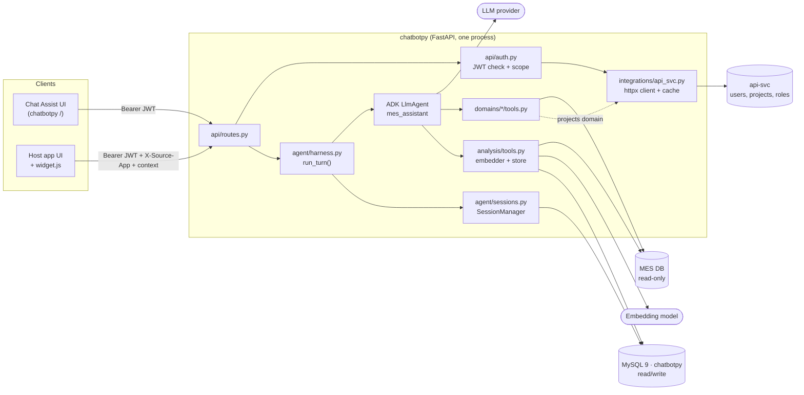
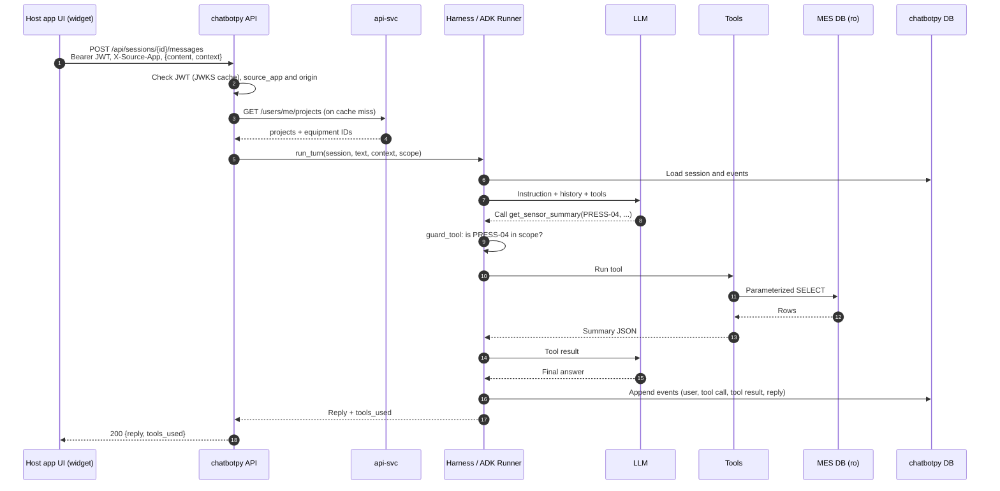
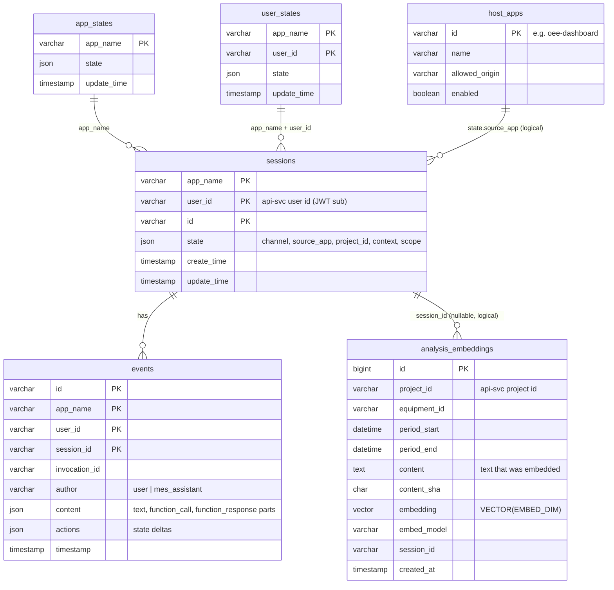
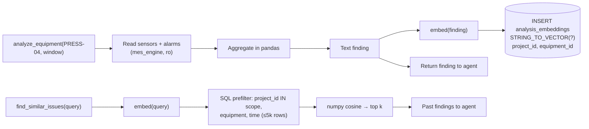

# Plan: chatbotpy, an MES assistant agent (Python, Google ADK, MySQL 9)

A standalone Python app that runs one Google ADK agent. The agent answers questions about shop-floor equipment by reading MES data **read-only**, keeps every session and message in MySQL 9, and stores the embeddings from its analyses in MySQL 9 `VECTOR` columns.

It serves two client channels through one API:

1. **Chat Assist**: the app's own web UI.
2. **Host apps**: other MES domain applications that embed a chat widget in their own web UI and pass along page context, such as the equipment the user is looking at.

**`api-svc`**, the main backend, stays the source of truth for users, projects and permissions. chatbotpy keeps no user or project tables of its own. It checks the user's api-svc token and asks api-svc which projects and equipment the user is allowed to see.

The existing Node app in `server/` and `public/` is left alone. chatbotpy goes in a new `chatbotpy/` folder and its own `chatbotpy` schema, so its tables can't collide with the Node app's `chatbot.sessions` table.

## Architecture



One process, one agent, two database connections and one HTTP client for api-svc. There are no queues, no sub-agents and no separate vector database.

## Interaction with api-svc

### What each side owns

| Concern | Owner | How chatbotpy gets it |
| --- | --- | --- |
| Users, login, tokens | api-svc | Checks the user's JWT against api-svc's JWKS, offline. Falls back to the introspection endpoint if tokens are opaque. |
| Projects, membership, roles | api-svc | `GET /users/me/projects`, called with the user's token and cached for 60 s |
| Which equipment belongs to a project | api-svc (assumed) | `GET /projects/{id}/equipment`, cached for 60 s |
| Chat sessions, messages, embeddings | chatbotpy | Its own `chatbotpy` schema |
| Equipment data | MES | Read-only `mes_reader` connection |

chatbotpy never writes to api-svc. In version 1, api-svc only calls chatbotpy in one case: deleting a user's chat data when the user is deleted.

### Calls between the services

| Direction | Call | Auth | Purpose |
| --- | --- | --- | --- |
| chatbotpy → api-svc | `GET /.well-known/jwks.json` | none | Keys for checking JWTs, cached for 1 h |
| chatbotpy → api-svc | `GET /users/me` | user's token | Display name and roles (optional, the JWT claims may be enough) |
| chatbotpy → api-svc | `GET /users/me/projects` | user's token | Projects the user can access, which sets their scope |
| chatbotpy → api-svc | `GET /projects/{id}/equipment` | user's token | Equipment IDs in that project |
| api-svc → chatbotpy | `DELETE /internal/users/{user_id}/data` | service token (client credentials) | Delete the user's sessions when the user is deleted |

The client in `integrations/api_svc.py` uses `httpx.AsyncClient` with a 3 s timeout, two retries on 5xx responses, and a `TTLCache`. If api-svc is down, cached scopes are still used until they expire. After that, requests fail with a 503 instead of running without a scope check.

### Authentication and scope on every request



How scope works:

- **User ID:** `user_id` in ADK is the JWT `sub`, so it is the same user ID that api-svc uses.
- **Session state:** each session stores `project_id`, which comes from the UI's project picker or the host app's context, along with `channel`, `source_app` and `context`.
- **Scope refresh:** at the start of each turn, the harness puts `scope = {project_ids, equipment_ids}` into session state, fresh from api-svc or its cache.
- **Enforcement:** `guard_tool`, the `before_tool_callback`, rejects any `equipment_id` or `project_id` argument that is not in scope, before the tool runs. Tools that list things filter by scope too. This check lives in one place for all tools.
- **Embeddings:** each `analysis_embeddings` row has `project_id`, and `find_similar_issues` only searches the user's projects.

## Stack and Python packages

Versions are pinned in `uv.lock`.

| Package | Used for |
| --- | --- |
| `google-adk` | `LlmAgent`, `Runner`, `FunctionTool`, `DatabaseSessionService`, `adk web`, `adk eval` |
| `google-genai` | Gemini models and embeddings (installed with ADK) |
| `litellm` | Optional, only for Claude or an on-prem model through ADK's `LiteLlm` |
| `fastapi` and `uvicorn[standard]` | HTTP API and static files |
| `pydantic-settings` | Config from `.env` |
| `sqlalchemy` | Both database engines (ADK uses it too) |
| `pymysql` | Sync MySQL driver for the MES engine |
| `aiomysql` | Async MySQL driver, if the installed ADK version's `DatabaseSessionService` is async (checked in step 1) |
| `httpx` | Client for api-svc |
| `pyjwt[crypto]` | Checking JWTs with `PyJWKClient` |
| `cachetools` | `TTLCache` for scopes and JWKS |
| `pandas` and `numpy` | Sensor and alarm aggregation, cosine ranking |
| `sentence-transformers` | Optional, only for local embeddings on an air-gapped site |
| **dev:** `pytest`, `pytest-asyncio`, `respx`, `ruff` | Tests, mocking api-svc, lint |

## Folder layout

```text
chatbotpy/
├── pyproject.toml / uv.lock
├── Dockerfile
├── docker-compose.yml          # mysql:9 + app (+ api-svc stub for dev)
├── .env.example
├── db/
│   ├── 001_app.sql             # chatbotpy schema: host_apps, analysis_embeddings
│   └── 002_mes_mock.sql        # dev only: mes schema, seed data, mes_reader user
├── app/
│   ├── main.py                 # FastAPI app, static files, CORS
│   ├── config.py               # pydantic-settings
│   ├── db.py                   # app_engine (rw), mes_engine (ro)
│   ├── api/
│   │   ├── routes.py           # sessions and messages endpoints, /internal
│   │   └── auth.py             # JWT check, source_app, builds RequestCtx
│   ├── integrations/
│   │   └── api_svc.py          # httpx client, JWKS, scope cache
│   ├── agent/
│   │   ├── root_agent.py       # LlmAgent definition and instruction
│   │   ├── harness.py          # run_turn(), guard_tool, limits
│   │   └── sessions.py         # SessionManager over DatabaseSessionService
│   ├── domains/
│   │   ├── equipment/          # repo.py (fixed SELECTs), tools.py
│   │   ├── alarms/             # repo.py, tools.py
│   │   └── projects/           # tools.py, backed by the api-svc client (read-only)
│   └── analysis/
│       ├── embedder.py         # embed(texts) -> list[list[float]]
│       ├── store.py            # write and search analysis_embeddings
│       └── tools.py            # analyze_equipment, find_similar_issues
├── web/
│   ├── index.html, chat.js, styles.css   # Chat Assist
│   └── widget.js               # embeddable launcher for host apps
└── tests/
    ├── stubs/api_svc.py        # tiny FastAPI stub of api-svc for dev and tests
    ├── test_tools.py
    ├── test_scope.py           # out-of-scope equipment is rejected
    ├── test_readonly.py        # writes through mes_engine fail
    └── evals/*.evalset.json    # ADK evals (`adk eval`)
```

## Database tables

### Schemas and users

| Schema | DB user | Access | Tables |
| --- | --- | --- | --- |
| `chatbotpy` | `chatbotpy` | read/write | ADK: `sessions`, `events`, `app_states`, `user_states`. Ours: `host_apps`, `analysis_embeddings`. |
| `mes` (mock in dev, real or replica in prod) | `mes_reader` | `SELECT` only | `equipment`, `sensor_tags`, `sensor_readings`, `alarms` |

There are no user or project tables, because api-svc owns those.

### chatbotpy tables



ADK creates and migrates `sessions`, `events`, `app_states` and `user_states` itself. Their columns are shown as a guide and can differ slightly between ADK versions. Our own tables are below.

```sql
CREATE TABLE host_apps (
  id              VARCHAR(64)  PRIMARY KEY,
  name            VARCHAR(255) NOT NULL,
  allowed_origin  VARCHAR(255) NULL,
  enabled         BOOLEAN      NOT NULL DEFAULT TRUE
);

CREATE TABLE analysis_embeddings (
  id            BIGINT UNSIGNED AUTO_INCREMENT PRIMARY KEY,
  project_id    VARCHAR(64)   NOT NULL,
  equipment_id  VARCHAR(64)   NOT NULL,
  period_start  DATETIME(3)   NOT NULL,
  period_end    DATETIME(3)   NOT NULL,
  content       TEXT          NOT NULL,
  content_sha   CHAR(64)      NOT NULL,
  embedding     VECTOR(768)   NOT NULL,        -- = EMBED_DIM
  embed_model   VARCHAR(64)   NOT NULL,
  session_id    VARCHAR(128)  NULL,
  created_at    TIMESTAMP(3)  NOT NULL DEFAULT CURRENT_TIMESTAMP(3),
  UNIQUE KEY uq_model_sha (embed_model, content_sha),
  KEY idx_project_equipment_period (project_id, equipment_id, period_start)
) ENGINE=InnoDB DEFAULT CHARSET=utf8mb4;
```

`host_apps` no longer holds an API key. Users authenticate with their own api-svc JWT on both channels, so `host_apps` is only an allowlist of which apps can embed the widget, from which origins.

### MES tables (read-only; the mock mirrors the expected shape)

| Table | Key columns |
| --- | --- |
| `mes.equipment` | `equipment_id`, `name`, `area`, `type`, `status`, `status_since` |
| `mes.sensor_tags` | `equipment_id`, `tag`, `unit`, `lo_limit`, `hi_limit` |
| `mes.sensor_readings` | `equipment_id`, `tag`, `ts`, `value`, indexed on (`equipment_id`, `tag`, `ts`) |
| `mes.alarms` | `alarm_id`, `equipment_id`, `code`, `text`, `severity`, `start_ts`, `end_ts` |

## How the parts fit together

### Agent (`agent/root_agent.py`)

```python
root_agent = LlmAgent(
    name="mes_assistant",
    model=settings.model,                      # "gemini-..." or LiteLlm(...)
    instruction=INSTRUCTION,                   # uses {source_app?} {project_id?} {context?}
    tools=[list_my_projects, list_equipment, get_equipment_status,
           get_sensor_summary, get_alarms, analyze_equipment, find_similar_issues],
    before_tool_callback=harness.guard_tool,
)
```

The instruction tells the agent to answer only from tool results, to cite the equipment and time window it used, and to say so when the data doesn't cover the question or is outside the user's projects.

### Harness (`agent/harness.py`)

`run_turn(ctx, session_id, text, context) -> Reply` is the only code that runs the agent. It:

- writes `context` and a fresh `scope` into session state
- calls `Runner.run_async`
- enforces a 60 s time limit and at most 8 tool calls per turn
- runs `guard_tool`, which checks limits and scope before every tool call
- turns errors into a short message the user can read

The API, `adk web` and the tests all go through this function.

### Session manager (`agent/sessions.py`)

ADK's `DatabaseSessionService(db_url=APP_DB_URL)` stores everything: each message, tool call and tool result is an `events` row, which also gives a full audit trail. `SessionManager` wraps it with:

- `create(ctx, project_id, context)`
- `list(ctx)` for the user's sessions with their origin and project
- `messages(id)` to turn events into `{role, text, tools, ts}` rows for the UI
- `delete(id)`
- `delete_user(user_id)`, used by the api-svc callback

### Domains

| Domain | Data source | Tools |
| --- | --- | --- |
| projects | api-svc (read-only, via the cached client) | `list_my_projects()` |
| equipment | MES | `list_equipment(project_id?, area?)`, `get_equipment_status(equipment_id)`, `get_sensor_summary(equipment_id, tag, start, end)`, which returns stats, out-of-limit counts and trend, not raw rows |
| alarms | MES | `get_alarms(equipment_id, start, end)`, which returns counts by code, total duration and the top N |

### Read-only equipment data

The MES data is protected at four levels:

1. **Database grants:** `mes_reader` only has `GRANT SELECT` on `mes.*`.
2. **Connection:** every `mes_engine` connection runs `SET SESSION TRANSACTION READ ONLY` when it opens.
3. **Code:** the repos only contain parameterized `SELECT`s, and tools never accept SQL.
4. **Limits:** time windows are capped at 7 days, rows at 50k, and the data is aggregated in Python before anything reaches the LLM.

### Analysis and embeddings: where they are stored

**The embeddings are stored in `chatbotpy.analysis_embeddings`, in a `VECTOR` column. They are never stored in MES or api-svc.**



Only analysis findings are embedded, so the table grows by one row per analysis. `content_sha` stops duplicate rows when the same analysis runs twice.

MySQL 9 Community has the `VECTOR` type, but `DISTANCE()` and vector indexes are only in HeatWave. That is why ranking happens in numpy after a SQL prefilter. On HeatWave, only `store.search()` changes, to `ORDER BY DISTANCE(...)`.

### The two channels (`api/auth.py`)

| | Chat Assist | Host app |
| --- | --- | --- |
| UI | `web/index.html` at `/` | The host page loads `/widget.js`, which shows a launcher and an iframe |
| Token | The user's api-svc JWT, from the shared login | The host app passes its user's api-svc JWT to the widget |
| Identifies as | `channel="assist"` | `channel="host"`, `X-Source-App` must be an enabled `host_apps` row |
| Project | Picker in the UI, filled by `list_my_projects` | `data-context='{"project_id":"P-12","equipment_id":"PRESS-04"}'` |
| CORS | Not needed | `host_apps.allowed_origin` |

Every request ends up as the same `RequestCtx(user_id, roles, channel, source_app, scope)`. Both channels show the same sessions in Chat Assist, labeled with where they came from.

## API

| Method | Route | Auth | Purpose |
| --- | --- | --- | --- |
| `POST` | `/api/sessions` | user JWT | `{project_id?, context?}` → `{id}` |
| `GET` | `/api/sessions` | user JWT | The user's sessions, with origin and project |
| `GET` | `/api/sessions/{id}/messages` | user JWT | Messages built from events |
| `POST` | `/api/sessions/{id}/messages` | user JWT | `{content, context?}` → `{reply, tools_used[]}` |
| `DELETE` | `/api/sessions/{id}` | user JWT | Delete a session |
| `DELETE` | `/internal/users/{user_id}/data` | api-svc service token | Delete everything for a removed user |
| `GET` | `/health` | none | Status of the app DB, the MES DB (read-only check), api-svc and the model |
| `GET` | `/widget.js` | none | The embed script for host apps |

## Docker Compose and config

- **`db`:** `mysql:9.x`, port `3037:3306` (3036 is taken by the Node app's MySQL 8.4), a `mysqldata` volume and the `db/*.sql` init scripts.
- **`app`:** `python:3.12-slim`, port `8080:8080`, with `depends_on: db (service_healthy)`.
- **`api-svc-stub`** (dev only): `tests/stubs/api_svc.py`, which serves JWKS, `/users/me/projects` and `/projects/{id}/equipment` with fixed data.

```dotenv
APP_DB_URL=mysql+aiomysql://chatbotpy:chatbotpypass@db:3306/chatbotpy
MES_DB_URL=mysql+pymysql://mes_reader:readerpass@db:3306/mes
API_SVC_URL=http://api-svc:8000
API_SVC_JWKS_URL=http://api-svc:8000/.well-known/jwks.json
API_SVC_ISSUER=api-svc
API_SVC_AUDIENCE=chatbotpy
API_SVC_SERVICE_CLIENT_ID=chatbotpy        # checks api-svc's calls to /internal
MODEL=gemini-2.5-flash                     # or anthropic/claude-opus-5-5 via LiteLlm
GOOGLE_API_KEY=
ANTHROPIC_API_KEY=
EMBED_MODEL=text-embedding-004
EMBED_DIM=768                              # must match VECTOR(n)
```

## Build steps

Each step ships a Claude Code skill in `.claude/skills/<name>/SKILL.md`. A skill is a thin wrapper over a `python -m app <command>` subcommand, so the same check runs from the terminal, from CI and from Claude. Later steps reuse the skills from earlier ones.

| # | Step | What gets built | Skills added |
| --- | --- | --- | --- |
| 0 | **Shell app** ✅ | `pyproject.toml`, `.env` / `.env.example`, `app/config.py`, `app/db.py` (app engine rw, MES engine ro), `app/cli.py` | `ping`: connect to each datasource (`app` and `mes` on MySQL 9, `chatbotjs` on the Node app's MySQL 8.4) and report version, VECTOR support, user, latency and read-only status. `analyze-datasource-schema`: read schema and table names (plus PKs, indexes, FKs, row estimates) and give a short analysis. |
| 1 | **Scaffold and check the riskiest pieces** | Compose file with `mysql:9`, the `chatbotpy` and `mes` schemas and users. Confirm `DatabaseSessionService` creates its tables on MySQL 9 and which driver it needs. Insert and read back one `VECTOR` row. Fallback: a small custom `BaseSessionService` (about 150 lines). | `db-up`: start compose, wait for healthy, apply `db/*.sql`, then run `ping`. `check-mysql9`: create ADK tables and round-trip one `VECTOR(EMBED_DIM)` row. |
| 2 | **api-svc integration** | The stub, `integrations/api_svc.py`, `api/auth.py`, tests for an expired token, a wrong audience, scope caching and api-svc being down | `mint-token`: sign a dev JWT for a given user and set of projects with the stub's key. `check-scope`: print the scope chatbotpy resolves for a token (projects, equipment, cache hit or miss). |
| 3 | **Domains** | Mock MES seed data, repos and tools, `test_readonly.py` | `seed-mes`: reload the mock MES data. `check-readonly`: try an `INSERT` through `mes_engine` and confirm it fails. `call-tool`: run one domain tool with JSON args and print its result. |
| 4 | **Agent and harness** | `root_agent`, `run_turn()`, `guard_tool`, `test_scope.py`, checked with `adk web` | `ask`: run one turn through `run_turn()` as a given user and print the reply and `tools_used`. |
| 5 | **Analysis** | Embedder, store, the two analysis tools, a test that the same analysis twice writes one row | `inspect-embeddings`: list recent `analysis_embeddings` rows by project and equipment and flag duplicate `content_sha` values. |
| 6 | **API and session manager** | Routes and the `/internal` delete endpoint | `smoke-api`: mint a token, then hit every route and `/health` and report the status codes. `inspect-session`: print a session's events as `{role, text, tools}` rows. |
| 7 | **UIs** | Chat Assist (with the project picker) and `widget.js` | `widget-host`: serve a dummy host page on another port that embeds the widget with a given context. |
| 8 | **Evals** | 10–20 `adk eval` cases: the right tool is chosen, read-only is respected, out-of-scope equipment is refused, the agent says "no data" when there is none | `run-evals`: run `adk eval` and summarize failures by case. |

**Done when:** a user logged in through api-svc can ask "why did PRESS-04 stop yesterday?" from both channels and get an answer that cites tool data. A user without access to PRESS-04's project should be refused. A row should land in `analysis_embeddings` with its `project_id`, a follow-up "seen this before?" should find it, and writes through `mes_engine` should fail.

## Assumptions about api-svc to confirm

1. It issues JWTs signed with keys published at a JWKS URL, and the token has `sub`, `aud`, `exp` and `roles`. If tokens are opaque, chatbotpy calls the introspection endpoint instead and caches the result for 60 s.
2. It exposes "my projects" and "a project's equipment" endpoints, or similar. If MES owns the equipment-to-project mapping instead, the `equipment` repo reads it and api-svc only provides project membership.
3. Host apps already have the user's api-svc token in the browser, through shared SSO, so they can pass it to the widget.
4. It can call a delete endpoint when a user is removed, or we skip that in v1 and run a nightly cleanup job.

## Other open decisions

1. **Model:** Gemini (native in ADK), Claude through `LiteLlm`, or an on-prem model if the plant network is air-gapped.
2. **Embedding model:** must be decided before step 1, because it fixes `VECTOR(n)`.
3. **The real MES source:** MySQL, SQL Server, or a historian. Only `MES_DB_URL`, the driver and the repo SQL change.

## Out of scope for v1

Streaming, sub-agents per domain, embedding raw alarm text or SOP documents, writing back to MES or api-svc, and separating data by plant.
